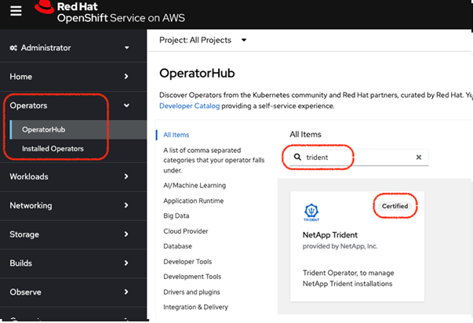
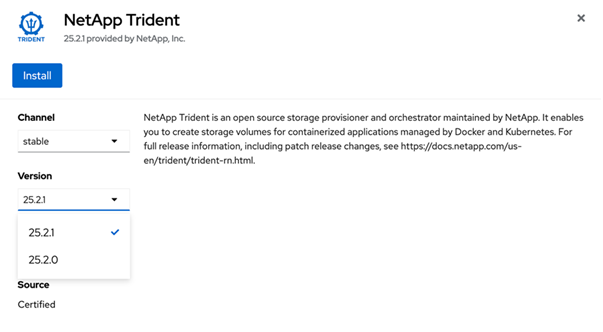
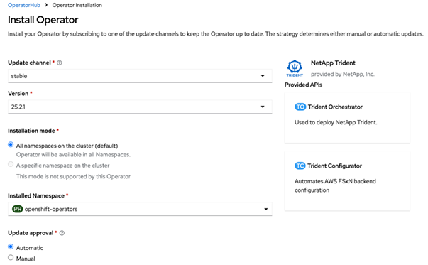
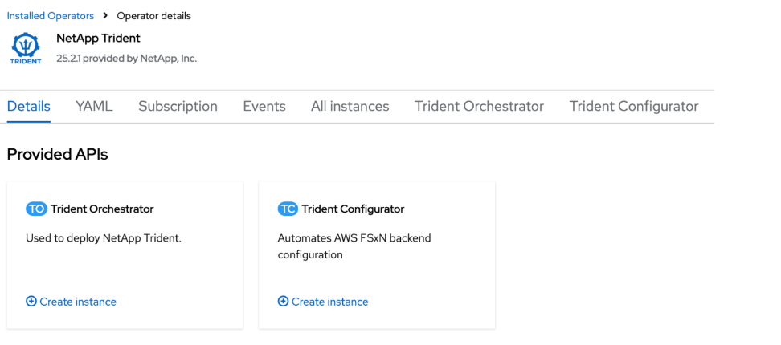
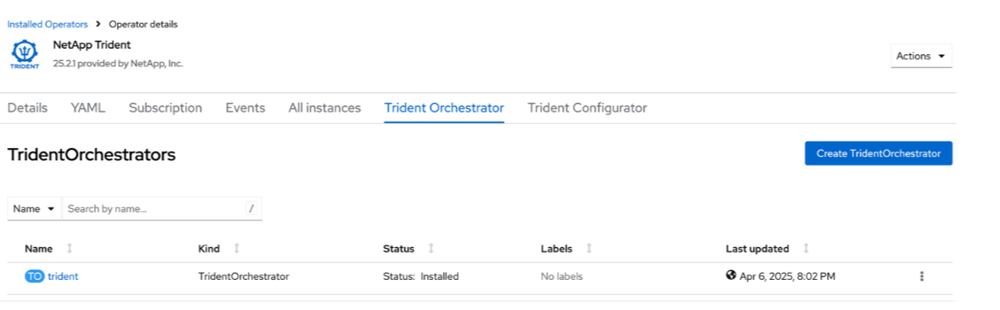

= Instale Trident usando OpenShift OperatorHub
:hardbreaks:
:allow-uri-read: 
:icons: font
:imagesdir: ../media/

[role="lead"]
Se você usa o Red Hat OpenShift, pode instalar NetApp Trident usando o operador certificado da Red Hat. Use este procedimento para instalar Trident a partir da Red Hat OpenShift Container Platform.

.Antes de começar
Antes de iniciar a instalação, link:../trident-get-started/requirements.html["prepare seu ambiente para a instalação do Trident"].

[[find-and-install-the-trident-operator]]
== Localize e instale o operador Trident

.Passos
. Navegue até OpenShift OperatorHub e pesquise por NetApp Trident.
+

. Clique em *NetApp Trident* para abrir as configurações de instalação.
. Selecione as opções necessárias e clique em *Instalar* para abrir a configuração do operador.
+

+

NOTE: Certifique-se de selecionar a versão mais recente do Operator.

. Mantenha todos os parâmetros como estão e clique em *Install*.
+

. Clique em *View Operator* para visualizar os detalhes do Operator.
+

. Clique em *visualização YAML* e cole o seguinte no formulário:
+
[source, yaml]
----
apiVersion: trident.netapp.io/v1
kind: TridentOrchestrator
metadata:
  name: trident
  namespace: openshift-operators
spec:
  IPv6: false
  debug: false
  nodePrep:
  - iscsi
  imageRegistry: ''
  k8sTimeout: 180s
  namespace: trident
  silenceAutosupport: false
----
+
[NOTE]
====
A interface do usuário fornece um exemplo padrão. Você pode editá-lo diretamente em vez de copiar uma configuração completa.

====

[NOTE]
====
Opcional: ativar concorrência

Para habilitar a concorrência, adicione o seguinte campo à especificação:

[source, yaml]
----
enableConcurrency: true
----
====
[NOTE]
====
* Red Hat Enterprise Linux CoreOS (RHCOS) não possui iSCSI habilitado e configurado.
* Você pode adicionar o  `nodePrep` parâmetro para configurar e habilitar os serviços iSCSI e Multipath em todos os nós de trabalho OpenShift.
* A partir do OpenShift 4.19, a versão mínima do Trident compatível com este recurso é 25.06.1.

====
. Clique em *Criar*; o Trident Orchestrator será totalmente instalado.
+

[[uninstall-trident-operator]]
== Desinstalar o operador Trident

.Passos
. Selecione o operador Trident na lista de operadores instalados.
. Selecione se deseja excluir todas as instâncias do operando do operador.
+

WARNING: Se você não selecionar a caixa de seleção *Excluir todas as instâncias de operandos deste operador*, Trident não será desinstalado.

. Clique em *Uninstall*.

