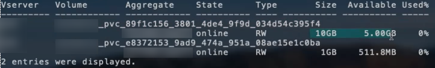

= Opções e exemplos de configuração do ONTAP NAS
:hardbreaks:
:allow-uri-read: 
:icons: font
:imagesdir: ../media/

[role="lead"]
Crie e utilize os drivers ONTAP NAS com sua instalação do Trident. Esta seção fornece exemplos de configuração de backend e detalhes para mapear backends para StorageClasses. A partir da versão 25.10, o NetApp Trident oferece suporte link:https://docs.netapp.com/us-en/ontap-afx/index.html["NetApp sistemas de storage AFX"^]. Os sistemas de armazenamento AFX da NetApp diferem de outros sistemas baseados em ONTAP (ASA, AFF e FAS) na implementação de sua camada de storage.

NOTE: Apenas o  `ontap-nas`driver (com protocolo NFS) é compatível com sistemas AFX da NetApp; o protocolo SMB não é compatível.

[[backend-configuration-options]]
== Opções de configuração do backend

Na configuração do backend do Trident, não é necessário especificar que seu sistema é um NetApp AFX sistema de storage. Ao selecionar  `ontap-nas` como o  `storageDriverName`, o Trident detecta automaticamente o sistema de storage AFX. Alguns parâmetros de configuração do backend não se aplicam a sistemas de storage AFX.

A partir da versão 26.06, você pode habilitar o posicionamento balanceado do ONTAP para que o ONTAP selecione o agregado para novos volumes. O posicionamento balanceado é necessário para sistemas de storage AFX no ONTAP 9.19.1 ou posterior. Consulte link:ontap-balanced-placement.html["Utilize o posicionamento balanceado com os backends ONTAP"] para requisitos e exemplos.

A tabela a seguir exibe as opções de configuração do backend:

[cols="1,3,2"]
|===
| Parâmetro | Descrição | Padrão 

| `version` |  | Sempre 1 

| `storageDriverName`  a| 
Nome do driver de armazenamento.

Não pode ser modificado após a criação. Para atualizar este parâmetro, você deve criar um novo backend.

NOTE: Para sistemas NetApp AFX, apenas  `ontap-nas` é suportado.
| `ontap-nas`, `ontap-nas-economy`, ou `ontap-nas-flexgroup` 

| `backendName` | Nome personalizado ou o storage backend | Nome do driver + "_" + dataLIF 

| `managementLIF` | Endereço IP de um cluster ou LIF de gerenciamento de SVM. Um nome de domínio totalmente qualificado (FQDN) pode ser especificado. Pode ser configurado para usar endereços IPv6 se Trident foi instalado com o sinalizador IPv6. Os endereços IPv6 devem ser definidos entre colchetes, como  `[28e8:d9fb:a825:b7bf:69a8:d02f:9e7b:3555]`. Para um switchover MetroCluster perfeito, consulte o <<mcc-best>>. | "10.0.0.1", "[2001:1234:abcd::fefe]" 

| `dataLIF` | Endereço IP do protocolo LIF. NetApp recomenda especificar `dataLIF`. Caso não seja fornecido, Trident busca os dataLIFs da SVM. Você pode especificar um nome de domínio totalmente qualificado (FQDN) para ser usado nas operações de montagem NFS, permitindo criar um DNS round-robin para balancear a carga entre vários dataLIFs. Pode ser alterado após a configuração inicial. Consulte . Pode ser configurado para usar endereços IPv6 se Trident foi instalado com o sinalizador IPv6. Os endereços IPv6 devem ser definidos entre colchetes, como  `[28e8:d9fb:a825:b7bf:69a8:d02f:9e7b:3555]`. *Omita para MetroCluster.* Consulte o <<mcc-best>>. | Endereço especificado ou derivado de SVM, caso não seja especificado (não recomendado) 

| `svm` | Máquina virtual de storage a ser usada *Omitir para MetroCluster.* Consulte o <<mcc-best>>. | Derivado se uma SVM `managementLIF` for especificada 

| `autoExportPolicy` | Ativar a criação e atualização automática de políticas de exportação [Booleano]. Usando as opções  `autoExportPolicy` e  `autoExportCIDRs`, Trident pode gerenciar políticas de exportação automaticamente. | falso 

| `autoExportCIDRs` | Lista de CIDRs para filtrar os IPs dos nós do Kubernetes quando `autoExportPolicy` estiver habilitado. Usando as opções  `autoExportPolicy` e  `autoExportCIDRs`, Trident pode gerenciar políticas de exportação automaticamente. | ["0.0.0.0/0", "::/0"]` 

| `labels` | Conjunto de rótulos arbitrários formatados em JSON para aplicar aos volumes | "" 

| `clientCertificate` | Valor codificado em Base64 do certificado do cliente. Usado para autenticação baseada em certificado | "" 

| `clientPrivateKey` | Valor codificado em Base64 da chave privada do cliente. Usado para autenticação baseada em certificado | "" 

| `trustedCACertificate` | Valor codificado em Base64 do certificado da CA confiável. Opcional. Usado para autenticação baseada em certificado | "" 

| `username` | Nome de usuário para conectar-se ao cluster/SVM. Usada para autenticação baseada em credenciais. Para autenticação do Active Directory, consulte link:../trident-use/ontap-san-examples.html#authenticate-trident-to-a-backend-svm-using-active-directory-credentials["Autentique o Trident em um SVM de backend usando credenciais do Active Directory"]. |  

| `password` | Senha para conectar-se ao cluster/SVM. Usada para autenticação baseada em credenciais. Para autenticação do Active Directory, consulte link:../trident-use/ontap-san-examples.html#authenticate-trident-to-a-backend-svm-using-active-directory-credentials["Autentique o Trident em um SVM de backend usando credenciais do Active Directory"]. |  

| `storagePrefix`  a| 
Prefixo usado ao provisionar novos volumes no SVM. Não pode ser atualizado após ser definido

NOTE: Ao usar o ontap-nas-economy e um storagePrefix com 24 ou mais caracteres, as qtrees não têm o storage prefix incorporado, embora ele esteja presente no nome do volume.
| "Trident" 

| `aggregate`  a| 
Agregado para provisionamento (opcional; se definido, deve ser atribuído à SVM). Para o  `ontap-nas-flexgroup` driver, esta opção é ignorada. Se não for atribuído, qualquer um dos agregados disponíveis pode ser usado para provisionar um FlexGroup volume.

NOTE: Quando o agregado é atualizado no SVM, ele é atualizado automaticamente no Trident por meio de polling no SVM, sem a necessidade de reiniciar o Trident Controller. Quando você configurou um agregado específico no Trident para provisionar volumes, se o agregado for renomeado ou movido para fora do SVM, o backend é movido para o estado de falha no Trident durante o polling do agregado no SVM. Você deve alterar o agregado para um que esteja presente no SVM ou removê-lo completamente para que o backend volte a ficar online.

*Não especifique para sistemas de storage AFX.*

*Não especifique quando  `useBalancedPlacement` estiver definido como  `true`.*
 a| 
""

| `useBalancedPlacement`  a| 
Delegar a seleção de aggregate para novos volumes ao ONTAP [Booleano]. Requer ONTAP 9.19.1 ou posterior e  `useREST` definido como  `true`. Não pode ser combinado com  `aggregate`.

Consulte link:ontap-balanced-placement.html["Utilize o posicionamento balanceado com os backends ONTAP"] para requisitos e exemplos.

*Se especificado, defina sempre como  `true` para sistemas de storage AFX no ONTAP 9.19.1 ou posterior.*
| `false`; `true` para sistemas de armazenamento AFX no ONTAP 9.19.1 ou posterior 

| `limitAggregateUsage` | O provisionamento falhará se o uso ultrapassar essa porcentagem. *Não se aplica ao Amazon FSx para ONTAP*. *Não especifique para sistemas de storage AFX.* | "" (não aplicado por padrão) 

| flexgroupAggregateList  a| 
Lista de agregados para provisionamento (opcional; se definida, deve ser atribuída à SVM). Todos os agregados atribuídos à SVM são usados para provisionar um FlexGroup volume. Compatível com o driver de storage *ontap-nas-flexgroup*.

NOTE: Quando a lista de agregados é atualizada no SVM, a lista é atualizada automaticamente no Trident por meio de consultas ao SVM, sem a necessidade de reiniciar o Trident Controller. Quando você configurou uma lista de agregados específica no Trident para provisionar volumes, se a lista de agregados for renomeada ou movida para fora do SVM, o backend será movido para o estado de falha no Trident durante a consulta à lista de agregados do SVM. Você deve alterar a lista de agregados para uma que esteja presente no SVM ou removê-la completamente para que o backend volte a ficar online.
| "" 

| `limitVolumeSize` | O provisionamento falha se o tamanho do volume solicitado for superior a este valor. | "" (não aplicado por padrão) 

| `debugTraceFlags` | Sinalizadores de depuração para usar na resolução de problemas. Exemplo, {"api":false, "method":true} não use  `debugTraceFlags` a menos que esteja solucionando problemas e precise de um despejo de log detalhado. | null 

| `nasType` | Configurar a criação de volumes NFS ou SMB. As opções são  `nfs`,  `smb` ou null. Definir como null define volumes NFS por padrão. *Se especificado, defina sempre como  `nfs` para sistemas de armazenamento AFX*. | `nfs` 

| `nfsMountOptions` | Lista separada por vírgulas de opções de montagem NFS. As opções de montagem para volumes persistentes do Kubernetes normalmente são especificadas nas classes de armazenamento, mas se nenhuma opção de montagem for especificada em uma classe de armazenamento, o Trident usará as opções de montagem especificadas no arquivo de configuração do backend de storage. Se nenhuma opção de montagem for especificada na classe de armazenamento ou no arquivo de configuração, o Trident não definirá nenhuma opção de montagem em um volume persistente associado. | "" 

| `qtreesPerFlexvol` | Máximo de Qtrees por FlexVol, deve estar no intervalo [50, 300] | "200" 

| `smbShare` | Você pode especificar uma das seguintes opções: o nome de um compartilhamento SMB criado usando o Microsoft Management Console ou ONTAP CLI; um nome para permitir que o Trident crie o compartilhamento SMB; ou você pode deixar o parâmetro em branco para impedir o acesso comum aos volumes. Este parâmetro é opcional para ONTAP on-premises. Este parâmetro é obrigatório para Amazon FSx for ONTAP backends e não pode ficar em branco. | `smb-share` 

| `useREST` | Parâmetro booleano para usar as ONTAP REST APIs.  `useREST` Quando definido como  `true`, Trident usa as ONTAP REST APIs para se comunicar com o backend; quando definido como  `false`, Trident usa chamadas ONTAPI (ZAPI) para se comunicar com o backend. Este recurso requer ONTAP 9.11.1 e versões posteriores. Além disso, a função de login do ONTAP utilizada deve ter acesso ao aplicativo `ontapi`. Isso é atendido pelas funções predefinidas `vsadmin` e `cluster-admin`. A partir da versão 24.06 do Trident e ONTAP 9.15.1 ou posterior,  `useREST` é definido como  `true` por padrão; altere  `useREST` para  `false` para usar chamadas ONTAPI (ZAPI). *Se especificado, defina sempre como  `true` para sistemas de armazenamento AFX*. | `true`para ONTAP 9.15.1 ou posterior, caso contrário `false`. 

| `limitVolumePoolSize` | Tamanho máximo solicitável de FlexVol ao usar Qtrees no backend ontap-nas-economy. | "" (não aplicado por padrão) 

| `denyNewVolumePools` | Restringe  `ontap-nas-economy` os backends de criarem novos volumes FlexVol para conter seus Qtrees. Somente FlexVols preexistentes são usados para o provisionamento de novos PVs. |  

| `adAdminUser` | Usuário ou grupo de usuários administradores do Active Directory com acesso total aos compartilhamentos SMB. Use este parâmetro para conceder direitos de administrador ao compartilhamento SMB com controle total. |  
|===

[[backend-configuration-options-for-provisioning-volumes]]
== Opções de configuração de backend para provisionamento de volumes

Você pode controlar o provisionamento padrão usando essas opções na seção  `defaults` do arquivo de configuração. Para um exemplo, veja os exemplos de configuração abaixo.

[cols="1,3,2"]
|===
| Parâmetro | Descrição | Padrão 

| `spaceAllocation` | Alocação de espaço para Qtrees | "true" 

| `spaceReserve` | Modo de reserva de espaço; "none" (fino) ou "volume" (grosso) | "none" 

| `snapshotPolicy` | Política do Snapshot a ser usada | "none" 

| `qosPolicy` | Grupo de políticas de QoS a ser atribuído aos volumes criados. Escolha uma de qosPolicy ou adaptiveQosPolicy por pool de storage/backend | "" 

| `adaptiveQosPolicy` | Grupo de políticas de QoS adaptável para atribuir aos volumes criados. Escolha um dos qosPolicy ou adaptiveQosPolicy por pool de storage/backend. Não compatível com ontap-nas-economy. | "" 

| `snapshotReserve` | Percentual do volume reservado para snapshots | "0" se  `snapshotPolicy` for "none", caso contrário "" 

| `splitOnClone` | Separar um clone de seu progenitor no momento da criação | "false" 

| `encryption` | Habilite a NetApp Volume Encryption (NVE) no novo volume; o padrão é  `false`. A NVE deve estar licenciada e habilitada no cluster para usar esta opção. Se a NAE estiver habilitada no backend, qualquer volume provisionado no Trident terá a NAE habilitada. Para mais informações, consulte: link:../trident-reco/security-reco.html["Como Trident funciona com NVE e NAE"]. | "false" 

| `tieringPolicy` | Política de tiering para usar "none" |  

| `unixPermissions` | Modo para novos volumes | "777" para volumes NFS; vazio (não aplicável) para volumes SMB 

| `snapshotDir` | Controla o acesso ao `.snapshot` diretório | `true`, `false` (Definido explicitamente). 

| `exportPolicy` | Política de exportação a ser usada | "default" 

| `securityStyle` | Estilo de segurança para novos volumes. NFS suporta  `mixed` e  `unix` estilos de segurança. SMB suporta  `mixed` e  `ntfs` estilos de segurança. | NFS default é `unix`. SMB default é `ntfs`. 

| `nameTemplate` | Modelo para criar nomes de volume personalizados. | "" 
|===

NOTE: O uso de grupos de políticas de QoS com Trident requer ONTAP 9.8 ou posterior. Você deve usar um grupo de políticas de QoS não compartilhado e garantir que o grupo de políticas seja aplicado a cada componente individualmente. Um grupo de políticas de QoS compartilhado impõe o limite máximo para a taxa de transferência total de todas as cargas de trabalho.

[[volume-provisioning-examples]]
=== Exemplos de provisionamento de volume

Aqui está um exemplo com valores padrão definidos:

[source, yaml]
----
---
version: 1
storageDriverName: ontap-nas
backendName: customBackendName
managementLIF: 10.0.0.1
dataLIF: 10.0.0.2
labels:
  k8scluster: dev1
  backend: dev1-nasbackend
svm: trident_svm
username: cluster-admin
password: <password>
limitAggregateUsage: 80%
limitVolumeSize: 50Gi
nfsMountOptions: nfsvers=4
debugTraceFlags:
  api: false
  method: true
defaults:
  spaceReserve: volume
  qosPolicy: premium
  exportPolicy: myk8scluster
  snapshotPolicy: default
  snapshotReserve: "10"
----
Para  `ontap-nas` e  `ontap-nas-flexgroups`, o Trident agora usa um novo cálculo para garantir que o FlexVol seja dimensionado corretamente com a porcentagem de snapshotReserve e o PVC. Quando o usuário solicita um PVC, o Trident cria o FlexVol original com mais espaço usando o novo cálculo. Esse cálculo garante que o usuário receba o espaço gravável solicitado no PVC, e não menos espaço do que o solicitado. Antes da v21.07, quando o usuário solicitava um PVC (por exemplo, 5 GiB), com o snapshotReserve em 50 por cento, ele recebia apenas 2,5 GiB de espaço gravável. Isso ocorre porque o que o usuário solicitava era o volume total e  `snapshotReserve` é uma porcentagem disso. Com o Trident 21.07, o que o usuário solicita é o espaço gravável e o Trident define o número de  `snapshotReserve` como a porcentagem do volume total. Isso não se aplica a  `ontap-nas-economy`. Veja o exemplo a seguir para ver como isso funciona:

O cálculo é o seguinte:

[listing]
----
Total volume size = <PVC requested size> / (1 - (<snapshotReserve percentage> / 100))
----
Para snapshotReserve = 50%, e solicitação de PVC = 5 GiB, o tamanho total do volume é 5/0,5 = 10 GiB e o tamanho disponível é 5 GiB, que é o que o usuário solicitou na solicitação de PVC. O comando  `volume show` deve exibir resultados semelhantes a este exemplo:

Os backends existentes de instalações anteriores provisionam volumes conforme explicado acima ao atualizar o Trident. Para volumes que você criou antes da atualização, você deve redimensionar esses volumes para que a alteração seja observada. Por exemplo, um PVC de 2 GiB com  `snapshotReserve=50` anteriormente resultava em um volume que fornece 1 GiB de espaço gravável. Redimensionar o volume para 3 GiB, por exemplo, fornece ao aplicativo 3 GiB de espaço gravável em um volume de 6 GiB.

[[minimal-configuration-examples]]
== Exemplos de configuração mínima

Os exemplos a seguir mostram configurações básicas que deixam a maioria dos parâmetros com os valores padrão. Esta é a maneira mais fácil de definir um backend.

NOTE: Se você estiver usando Amazon FSx no NetApp ONTAP com Trident, a recomendação é especificar nomes DNS para LIFs em vez de endereços IP.

.Exemplo de economia ONTAP NAS
[%collapsible]
====
[source, yaml]
----
---
version: 1
storageDriverName: ontap-nas-economy
managementLIF: 10.0.0.1
dataLIF: 10.0.0.2
svm: svm_nfs
username: vsadmin
password: password
----
====
.Exemplo de FlexGroup ONTAP NAS
[%collapsible]
====
[source, yaml]
----
---
version: 1
storageDriverName: ontap-nas-flexgroup
managementLIF: 10.0.0.1
dataLIF: 10.0.0.2
svm: svm_nfs
username: vsadmin
password: password
----
====
.Exemplo do MetroCluster
[#mcc-best%collapsible]
====
Você pode configurar o backend para evitar ter que atualizar manualmente a definição do backend após switchover e switchback durante link:../trident-reco/backup.html#svm-replication-and-recovery["Replicação e recuperação de SVM"].

Para switchover e switchback sem interrupções, especifique a SVM usando  `managementLIF` e omita os parâmetros  `dataLIF` e  `svm`. Por exemplo:

[source, yaml]
----
---
version: 1
storageDriverName: ontap-nas
managementLIF: 192.168.1.66
username: vsadmin
password: password
----
====
.Exemplo de volumes SMB
[%collapsible]
====
[source, yaml]
----
---
version: 1
backendName: ExampleBackend
storageDriverName: ontap-nas
managementLIF: 10.0.0.1
nasType: smb
securityStyle: ntfs
unixPermissions: ""
dataLIF: 10.0.0.2
svm: svm_nfs
username: vsadmin
password: password
----
====
.Exemplo de autenticação baseada em certificado
[%collapsible]
====
Este é um exemplo mínimo de configuração de backend.  `clientCertificate`,  `clientPrivateKey` e  `trustedCACertificate` (opcional, se estiver usando uma CA confiável) são preenchidos em  `backend.json` e recebem os valores codificados em base64 do certificado do cliente, da chave privada e do certificado da CA confiável, respectivamente.

[source, yaml]
----
---
version: 1
backendName: DefaultNASBackend
storageDriverName: ontap-nas
managementLIF: 10.0.0.1
dataLIF: 10.0.0.15
svm: nfs_svm
clientCertificate: ZXR0ZXJwYXB...ICMgJ3BhcGVyc2
clientPrivateKey: vciwKIyAgZG...0cnksIGRlc2NyaX
trustedCACertificate: zcyBbaG...b3Igb3duIGNsYXNz
storagePrefix: myPrefix_
----
====
.Exemplo de política de exportação automática
[%collapsible]
====
Este exemplo mostra como você pode instruir Trident a usar políticas de exportação dinâmicas para criar e gerenciar a política de exportação automaticamente. Isso funciona da mesma forma para os `ontap-nas-economy` e `ontap-nas-flexgroup`drivers.

[source, yaml]
----
---
version: 1
storageDriverName: ontap-nas
managementLIF: 10.0.0.1
dataLIF: 10.0.0.2
svm: svm_nfs
labels:
  k8scluster: test-cluster-east-1a
  backend: test1-nasbackend
autoExportPolicy: true
autoExportCIDRs:
- 10.0.0.0/24
username: admin
password: password
nfsMountOptions: nfsvers=4
----
====
.Exemplo de colocação equilibrada
[%collapsible]
====
Este exemplo habilita o posicionamento balanceado do ONTAP, de forma que o ONTAP selecione o agregado para novos volumes. O posicionamento balanceado requer o ONTAP 9.19.1 ou posterior. Consulte link:ontap-balanced-placement.html["Utilize o posicionamento balanceado com os backends ONTAP"] para obter detalhes.

[source, yaml]
----
---
version: 1
storageDriverName: ontap-nas
backendName: nas-balanced-placement
managementLIF: 10.0.0.1
dataLIF: 10.0.0.2
svm: svm_nfs
username: vsadmin
password: password
useBalancedPlacement: true
----
====
.Exemplo de endereços IPv6
[%collapsible]
====
Este exemplo mostra `managementLIF` usando um endereço IPv6.

[source, yaml]
----
---
version: 1
storageDriverName: ontap-nas
backendName: nas_ipv6_backend
managementLIF: "[5c5d:5edf:8f:7657:bef8:109b:1b41:d491]"
labels:
  k8scluster: test-cluster-east-1a
  backend: test1-ontap-ipv6
svm: nas_ipv6_svm
username: vsadmin
password: password
----
====
.Amazon FSx para ONTAP usando exemplo de volumes SMB
[%collapsible]
====
O `smbShare` parâmetro é necessário para Amazon FSx para ONTAP usando volumes SMB.

[source, yaml]
----
---
version: 1
backendName: SMBBackend
storageDriverName: ontap-nas
managementLIF: example.mgmt.fqdn.aws.com
nasType: smb
dataLIF: 10.0.0.15
svm: nfs_svm
smbShare: smb-share
clientCertificate: ZXR0ZXJwYXB...ICMgJ3BhcGVyc2
clientPrivateKey: vciwKIyAgZG...0cnksIGRlc2NyaX
trustedCACertificate: zcyBbaG...b3Igb3duIGNsYXNz
storagePrefix: myPrefix_
----
====
.Exemplo de configuração de backend com nameTemplate
[%collapsible]
====
[source, yaml]
----
---
version: 1
storageDriverName: ontap-nas
backendName: ontap-nas-backend
managementLIF: <ip address>
svm: svm0
username: <admin>
password: <password>
defaults:
  nameTemplate: "{{.volume.Name}}_{{.labels.cluster}}_{{.volume.Namespace}}_{{.vo\
    lume.RequestName}}"
labels:
  cluster: ClusterA
  PVC: "{{.volume.Namespace}}_{{.volume.RequestName}}"
----
====

[[examples-of-backends-with-virtual-pools]]
== Exemplos de backends com pools virtuais

Nos arquivos de definição de backend de exemplo mostrados abaixo, valores padrão específicos são definidos para todos os pools de storage, como  `spaceReserve` em none,  `spaceAllocation` em false e  `encryption` em false. Os pools virtuais são definidos na seção de storage.

Trident define rótulos de provisionamento no campo "Comentários". Os comentários são definidos em FlexVol para  `ontap-nas` ou FlexGroup para  `ontap-nas-flexgroup`. Trident copia todos os rótulos presentes em um pool virtual para o volume de armazenamento durante o provisionamento. Para conveniência, administradores de storage podem definir rótulos por pool virtual e agrupar volumes por rótulo.

Nestes exemplos, alguns pools de storage definem seus próprios  `spaceReserve`, `spaceAllocation`, e  `encryption` valores, e alguns pools substituem os valores padrão.

.Exemplo de ONTAP NAS
[%collapsible%open]
====
[source, yaml]
----
---
version: 1
storageDriverName: ontap-nas
managementLIF: 10.0.0.1
svm: svm_nfs
username: admin
password: <password>
nfsMountOptions: nfsvers=4
defaults:
  spaceReserve: none
  encryption: "false"
  qosPolicy: standard
labels:
  store: nas_store
  k8scluster: prod-cluster-1
region: us_east_1
storage:
  - labels:
      app: msoffice
      cost: "100"
    zone: us_east_1a
    defaults:
      spaceReserve: volume
      encryption: "true"
      unixPermissions: "0755"
      adaptiveQosPolicy: adaptive-premium
  - labels:
      app: slack
      cost: "75"
    zone: us_east_1b
    defaults:
      spaceReserve: none
      encryption: "true"
      unixPermissions: "0755"
  - labels:
      department: legal
      creditpoints: "5000"
    zone: us_east_1b
    defaults:
      spaceReserve: none
      encryption: "true"
      unixPermissions: "0755"
  - labels:
      app: wordpress
      cost: "50"
    zone: us_east_1c
    defaults:
      spaceReserve: none
      encryption: "true"
      unixPermissions: "0775"
  - labels:
      app: mysqldb
      cost: "25"
    zone: us_east_1d
    defaults:
      spaceReserve: volume
      encryption: "false"
      unixPermissions: "0775"

----
====
.Exemplo de ONTAP NAS FlexGroup
[%collapsible%open]
====
[source, yaml]
----
---
version: 1
storageDriverName: ontap-nas-flexgroup
managementLIF: 10.0.0.1
svm: svm_nfs
username: vsadmin
password: <password>
defaults:
  spaceReserve: none
  encryption: "false"
labels:
  store: flexgroup_store
  k8scluster: prod-cluster-1
region: us_east_1
storage:
  - labels:
      protection: gold
      creditpoints: "50000"
    zone: us_east_1a
    defaults:
      spaceReserve: volume
      encryption: "true"
      unixPermissions: "0755"
  - labels:
      protection: gold
      creditpoints: "30000"
    zone: us_east_1b
    defaults:
      spaceReserve: none
      encryption: "true"
      unixPermissions: "0755"
  - labels:
      protection: silver
      creditpoints: "20000"
    zone: us_east_1c
    defaults:
      spaceReserve: none
      encryption: "true"
      unixPermissions: "0775"
  - labels:
      protection: bronze
      creditpoints: "10000"
    zone: us_east_1d
    defaults:
      spaceReserve: volume
      encryption: "false"
      unixPermissions: "0775"

----
====
.Exemplo de economia ONTAP NAS
[%collapsible%open]
====
[source, yaml]
----
---
version: 1
storageDriverName: ontap-nas-economy
managementLIF: 10.0.0.1
svm: svm_nfs
username: vsadmin
password: <password>
defaults:
  spaceReserve: none
  encryption: "false"
labels:
  store: nas_economy_store
region: us_east_1
storage:
  - labels:
      department: finance
      creditpoints: "6000"
    zone: us_east_1a
    defaults:
      spaceReserve: volume
      encryption: "true"
      unixPermissions: "0755"
  - labels:
      protection: bronze
      creditpoints: "5000"
    zone: us_east_1b
    defaults:
      spaceReserve: none
      encryption: "true"
      unixPermissions: "0755"
  - labels:
      department: engineering
      creditpoints: "3000"
    zone: us_east_1c
    defaults:
      spaceReserve: none
      encryption: "true"
      unixPermissions: "0775"
  - labels:
      department: humanresource
      creditpoints: "2000"
    zone: us_east_1d
    defaults:
      spaceReserve: volume
      encryption: "false"
      unixPermissions: "0775"

----
====

[[map-backends-to-storageclasses]]
== Mapear back-ends para StorageClasses

As seguintes definições de StorageClass referem-se a <<Exemplos de backends com pools virtuais>>. Usando o campo  `parameters.selector`, cada StorageClass indica quais pools virtuais podem ser usados para hospedar um volume. O volume possui os aspectos definidos no pool virtual escolhido.

* O `protection-gold` StorageClass corresponde ao primeiro e ao segundo pool virtual no `ontap-nas-flexgroup` backend. Esses são os únicos pools que oferecem proteção de nível ouro.
+
[source, yaml]
----
apiVersion: storage.k8s.io/v1
kind: StorageClass
metadata:
  name: protection-gold
provisioner: csi.trident.netapp.io
parameters:
  selector: "protection=gold"
  fsType: "ext4"
----
* O  `protection-not-gold` StorageClass corresponde ao terceiro e quarto pool virtual no  `ontap-nas-flexgroup` backend. Estes são os únicos pools que oferecem um nível de proteção diferente do gold.
+
[source, yaml]
----
apiVersion: storage.k8s.io/v1
kind: StorageClass
metadata:
  name: protection-not-gold
provisioner: csi.trident.netapp.io
parameters:
  selector: "protection!=gold"
  fsType: "ext4"
----
* O  `app-mysqldb` StorageClass corresponde ao quarto pool virtual no  `ontap-nas` backend. Este é o único pool que oferece configuração de pool de storage para aplicativo do tipo mysqldb.
+
[source, yaml]
----
apiVersion: storage.k8s.io/v1
kind: StorageClass
metadata:
  name: app-mysqldb
provisioner: csi.trident.netapp.io
parameters:
  selector: "app=mysqldb"
  fsType: "ext4"
----
* O  `protection-silver-creditpoints-20k` StorageClass corresponde ao terceiro pool virtual no  `ontap-nas-flexgroup` backend. Este é o único pool que oferece proteção de nível prata e 20000 pontos de crédito.
+
[source, yaml]
----
apiVersion: storage.k8s.io/v1
kind: StorageClass
metadata:
  name: protection-silver-creditpoints-20k
provisioner: csi.trident.netapp.io
parameters:
  selector: "protection=silver; creditpoints=20000"
  fsType: "ext4"
----
* O  `creditpoints-5k` StorageClass corresponde ao terceiro pool virtual no  `ontap-nas` backend e ao segundo pool virtual no  `ontap-nas-economy` backend. Essas são as únicas ofertas de pool com 5000 creditpoints.
+
[source, yaml]
----
apiVersion: storage.k8s.io/v1
kind: StorageClass
metadata:
  name: creditpoints-5k
provisioner: csi.trident.netapp.io
parameters:
  selector: "creditpoints=5000"
  fsType: "ext4"
----

O Trident decide qual pool virtual será selecionado e garante que o requisito de storage seja atendido.

[[update-datalif-after-initial-configuration]]
== Atualize `dataLIF` após a configuração inicial

Você pode alterar o dataLIF após a configuração inicial executando o seguinte comando para fornecer o novo arquivo JSON de backend com o dataLIF atualizado.

[listing]
----
tridentctl update backend <backend-name> -f <path-to-backend-json-file-with-updated-dataLIF>
----

NOTE: Se os PVCs estiverem conectados a um ou mais pods, você deve desligar todos os pods correspondentes e então ligá-los novamente para que o novo dataLIF entre em vigor.

[[secure-smb-examples]]
== Exemplos seguros de SMB

[[backend-configuration-with-ontap-nas-driver]]
=== Configuração de backend com o driver ontap-nas

[source, yaml]
----
apiVersion: trident.netapp.io/v1
kind: TridentBackendConfig
metadata:
  name: backend-tbc-ontap-nas
  namespace: trident
spec:
  version: 1
  storageDriverName: ontap-nas
  managementLIF: 10.0.0.1
  svm: svm2
  nasType: smb
  defaults:
    adAdminUser: tridentADtest
  credentials:
    name: backend-tbc-ontap-invest-secret
----

[[backend-configuration-with-ontap-nas-economy-driver]]
=== Configuração de backend com o driver ontap-nas-economy

[source, yaml]
----
apiVersion: trident.netapp.io/v1
kind: TridentBackendConfig
metadata:
  name: backend-tbc-ontap-nas
  namespace: trident
spec:
  version: 1
  storageDriverName: ontap-nas-economy
  managementLIF: 10.0.0.1
  svm: svm2
  nasType: smb
  defaults:
    adAdminUser: tridentADtest
  credentials:
    name: backend-tbc-ontap-invest-secret
----

[[backend-configuration-with-storage-pool]]
=== Configuração de backend com pool de storage

[source, yaml]
----
apiVersion: trident.netapp.io/v1
kind: TridentBackendConfig
metadata:
  name: backend-tbc-ontap-nas
  namespace: trident
spec:
  version: 1
  storageDriverName: ontap-nas
  managementLIF: 10.0.0.1
  svm: svm0
  useREST: false
  storage:
  - labels:
      app: msoffice
    defaults:
      adAdminUser: tridentADuser
  nasType: smb
  credentials:
    name: backend-tbc-ontap-invest-secret

----

[[storage-class-example-with-ontap-nas-driver]]
=== Exemplo de classe de armazenamento com o driver ontap-nas

[source, yaml]
----
apiVersion: storage.k8s.io/v1
kind: StorageClass
metadata:
  name: ontap-smb-sc
  annotations:
    trident.netapp.io/smbShareAdUserPermission: change
    trident.netapp.io/smbShareAdUser: tridentADtest
parameters:
  backendType: ontap-nas
  csi.storage.k8s.io/node-stage-secret-name: smbcreds
  csi.storage.k8s.io/node-stage-secret-namespace: trident
  trident.netapp.io/nasType: smb
provisioner: csi.trident.netapp.io
reclaimPolicy: Delete
volumeBindingMode: Immediate
----

NOTE: Certifique-se de adicionar  `annotations` para habilitar o SMB seguro. O SMB seguro não funciona sem as anotações, independentemente das configurações definidas no Backend ou no PVC.

[[storage-class-example-with-ontap-nas-economy-driver]]
=== Exemplo de classe de armazenamento com o driver ontap-nas-economy

[source, yaml]
----
apiVersion: storage.k8s.io/v1
kind: StorageClass
metadata:
  name: ontap-smb-sc
  annotations:
    trident.netapp.io/smbShareAdUserPermission: change
    trident.netapp.io/smbShareAdUser: tridentADuser3
parameters:
  backendType: ontap-nas-economy
  csi.storage.k8s.io/node-stage-secret-name: smbcreds
  csi.storage.k8s.io/node-stage-secret-namespace: trident
  trident.netapp.io/nasType: smb
provisioner: csi.trident.netapp.io
reclaimPolicy: Delete
volumeBindingMode: Immediate
----

[[pvc-example-with-a-single-ad-user]]
=== Exemplo de PVC com um único usuário AD

[source, yaml]
----
apiVersion: v1
kind: PersistentVolumeClaim
metadata:
  name: my-pvc4
  namespace: trident
  annotations:
    trident.netapp.io/smbShareAccessControl: |
      change:
        - tridentADtest
      read:
        - tridentADuser
spec:
  accessModes:
    - ReadWriteOnce
  resources:
    requests:
      storage: 1Gi
  storageClassName: ontap-smb-sc
----

[[pvc-example-with-multiple-ad-users]]
=== Exemplo de PVC com vários usuários de AD

[source, yaml]
----
apiVersion: v1
kind: PersistentVolumeClaim
metadata:
  name: my-test-pvc
  annotations:
    trident.netapp.io/smbShareAccessControl: |
      full_control:
        - tridentTestuser
        - tridentuser
        - tridentTestuser1
        - tridentuser1
      change:
        - tridentADuser
        - tridentADuser1
        - tridentADuser4
        - tridentTestuser2
      read:
        - tridentTestuser2
        - tridentTestuser3
        - tridentADuser2
        - tridentADuser3
spec:
  accessModes:
    - ReadWriteOnce
  resources:
    requests:
      storage: 1Gi
----