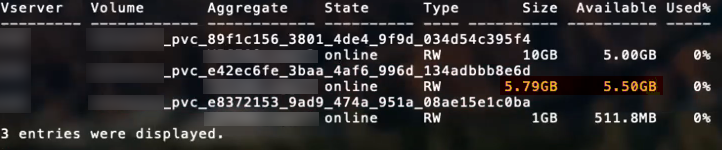

= Opções e exemplos de configuração do ONTAP SAN
:hardbreaks:
:allow-uri-read: 
:icons: font
:imagesdir: ../media/

[role="lead"]
Crie e utilize os drivers ONTAP SAN com sua instalação do Trident. Esta seção fornece exemplos de configuração de backend e detalhes para mapear backends para StorageClasses. link:https://docs.netapp.com/us-en/asa-r2/get-started/learn-about.html["Sistemas ASA r2"^] diferem de outros sistemas ONTAP (ASA, AFF e FAS) na implementação de sua camada de storage. Essas variações impactam o uso de certos parâmetros conforme indicado. link:https://docs.netapp.com/us-en/asa-r2/learn-more/hardware-comparison.html["Saiba mais sobre as diferenças entre sistemas ASA r2 e outros sistemas ONTAP"^]. Na configuração de backend do Trident, você não precisa especificar que seu sistema é ASA r2. Ao selecionar  `ontap-san` como o  `storageDriverName`, o Trident detecta automaticamente o ASA r2 ou outros sistemas ONTAP. Alguns parâmetros de configuração de backend não se aplicam a sistemas ASA r2, conforme observado na tabela abaixo.

NOTE: Apenas o  `ontap-san`driver (com os protocolos iSCSI, NVMe/TCP e FC) é compatível com sistemas ASA r2.

[[backend-configuration-options]]
== Opções de configuração do backend

A partir da versão 26.06, você pode habilitar o posicionamento balanceado do ONTAP para que o ONTAP selecione o agregado para novos volumes. Consulte link:ontap-balanced-placement.html["Utilize o posicionamento balanceado com os backends ONTAP"] para requisitos e exemplos.

Consulte a tabela a seguir para as opções de configuração do backend:

[cols="1,3,2"]
|===
| Parâmetro | Descrição | Padrão 

| `version` |  | Sempre 1 

| `storageDriverName` | Nome do driver de armazenamento. Não pode ser modificado após a criação. Para atualizar este parâmetro, você deve criar um novo backend. | `ontap-san` ou `ontap-san-economy` 

| `backendName` | Nome personalizado ou o storage backend | Nome do driver + "_" + dataLIF 

| `managementLIF`  a| 
Endereço IP de um cluster ou LIF de gerenciamento de SVM.

É possível especificar um nome de domínio totalmente qualificado (FQDN).

Pode ser configurado para usar endereços IPv6 se Trident foi instalado com o sinalizador IPv6. Os endereços IPv6 devem ser definidos entre colchetes, como  `[28e8:d9fb:a825:b7bf:69a8:d02f:9e7b:3555]`.

Para um switchover MetroCluster perfeito, consulte o <<mcc-best>>.

NOTE: Se estiver usando credenciais "vsadmin",  `managementLIF` deve ser a da SVM; se estiver usando credenciais "admin",  `managementLIF` deve ser a do cluster.
| "10.0.0.1", "[2001:1234:abcd::fefe]" 

| `dataLIF` | Endereço IP do protocolo LIF. Pode ser configurado para usar endereços IPv6 se Trident foi instalado com o sinalizador IPv6. Os endereços IPv6 devem ser definidos entre colchetes, como  `[28e8:d9fb:a825:b7bf:69a8:d02f:9e7b:3555]`. *Não especifique para iSCSI.* Trident usa link:https://docs.netapp.com/us-en/ontap/san-admin/selective-lun-map-concept.html["Mapa de LUN seletivo do ONTAP"^] para descobrir os LIFs iSCSI necessários para estabelecer uma sessão de múltiplos caminhos. Um aviso é gerado se  `dataLIF` for definido explicitamente. *Omita para MetroCluster.* Consulte o <<mcc-best>>. | Derivado pelo SVM 

| `svm` | Máquina virtual de storage a ser usada *Omitir para MetroCluster.* Consulte o <<mcc-best>>. | Derivado se uma SVM `managementLIF` for especificada 

| `useCHAP` | Use CHAP para autenticar iSCSI para drivers ONTAP SAN [parâmetro booleano]. Defina como  `true` para que Trident configure e use CHAP bidirecional como autenticação padrão para o SVM fornecido no backend. Consulte link:ontap-san-prep.html["Prepare-se para configurar o backend com os drivers ONTAP SAN"] para obter detalhes. *Não compatível com FCP ou NVMe/TCP.* | `false` 

| `chapInitiatorSecret` | Segredo do iniciador CHAP. Obrigatório se `useCHAP=true` | "" 

| `labels` | Conjunto de rótulos arbitrários formatados em JSON para aplicar aos volumes | "" 

| `chapTargetInitiatorSecret` | Segredo do iniciador do alvo CHAP. Obrigatório se `useCHAP=true` | "" 

| `chapUsername` | Nome de usuário de entrada. Obrigatório se `useCHAP=true` | "" 

| `chapTargetUsername` | Nome de usuário de destino. Obrigatório se `useCHAP=true` | "" 

| `clientCertificate` | Valor codificado em Base64 do certificado do cliente. Usado para autenticação baseada em certificado | "" 

| `clientPrivateKey` | Valor codificado em Base64 da chave privada do cliente. Usado para autenticação baseada em certificado | "" 

| `trustedCACertificate` | Valor codificado em Base64 do certificado da CA confiável. Opcional. Usado para autenticação baseada em certificado. | "" 

| `username` | Nome de usuário necessário para se comunicar com o cluster ONTAP. Usada para autenticação baseada em credenciais. Para autenticação do Active Directory, consulte link:../trident-use/ontap-san-examples.html#authenticate-trident-to-a-backend-svm-using-active-directory-credentials["Autentique o Trident em um SVM de backend usando credenciais do Active Directory"]. | "" 

| `password` | Senha necessária para se comunicar com o cluster ONTAP. Usada para autenticação baseada em credenciais. Para autenticação do Active Directory, consulte link:../trident-use/ontap-san-examples.html#authenticate-trident-to-a-backend-svm-using-active-directory-credentials["Autentique o Trident em um SVM de backend usando credenciais do Active Directory"]. | "" 

| `svm` | Máquina virtual de storage para usar | Derivado se uma SVM `managementLIF` for especificada 

| `storagePrefix` | Prefixo usado ao provisionar novos volumes no SVM. Não pode ser modificado posteriormente. Para atualizar este parâmetro, você precisa criar um novo backend. | `trident` 

| `aggregate`  a| 
Agregado para provisionamento (opcional; se definido, deve ser atribuído à SVM). Para o  `ontap-nas-flexgroup` driver, esta opção é ignorada. Se não for atribuído, qualquer um dos agregados disponíveis pode ser usado para provisionar um FlexGroup volume.

NOTE: Quando o agregado é atualizado no SVM, ele é atualizado automaticamente no Trident por meio de polling no SVM, sem a necessidade de reiniciar o Trident Controller. Quando você configurou um agregado específico no Trident para provisionar volumes, se o agregado for renomeado ou movido para fora do SVM, o backend entra em estado de falha no Trident durante o polling do agregado no SVM. Você deve alterar o agregado para um que esteja presente no SVM ou removê-lo completamente para que o backend volte a ficar online.

*Não especificar para sistemas ASA r2*.

*Não especifique quando  `useBalancedPlacement` estiver definido como  `true`.*
 a| 
""

| `useBalancedPlacement`  a| 
Delegar a seleção de aggregate para novos volumes ao ONTAP [Booleano]. Requer ONTAP 9.19.1 ou posterior e  `useREST` definido como  `true`. Não pode ser combinado com  `aggregate`.

Consulte link:ontap-balanced-placement.html["Utilize o posicionamento balanceado com os backends ONTAP"] para requisitos e exemplos.
| `false` 

| `limitAggregateUsage` | O provisionamento falhará se o uso ultrapassar essa porcentagem. Se você estiver usando um Amazon FSx para NetApp ONTAP backend, não especifique  `limitAggregateUsage`. As configurações fornecidas `fsxadmin` e `vsadmin` não contêm as permissões necessárias para recuperar o uso agregado e limitá-lo usando Trident. *Não especificar para sistemas ASA r2*. | "" (não aplicado por padrão) 

| `limitVolumeSize` | O provisionamento falha se o tamanho do volume solicitado for superior a este valor. Também restringe o tamanho máximo dos volumes que gerencia para LUNs. | "" (não aplicado por padrão) 

| `lunsPerFlexvol` | Número máximo de LUNs por FlexVol, deve estar no intervalo [50, 200] | `100` 

| `debugTraceFlags` | Sinalizadores de depuração para usar na resolução de problemas. Exemplo, {"api":false, "method":true} Não use a menos que esteja solucionando problemas e precise de um despejo de log detalhado. | `null` 

| `useREST`  a| 
Parâmetro booleano para usar as ONTAP REST APIs.

 `useREST` Quando definido como  `true`, Trident usa as ONTAP REST APIs para se comunicar com o backend; quando definido como  `false`, Trident usa chamadas ONTAPI (ZAPI) para se comunicar com o backend. Este recurso requer ONTAP 9.11.1 e versões posteriores. Além disso, a função de login do ONTAP utilizada deve ter acesso ao aplicativo `ontapi`. Isso é atendido pelas funções predefinidas `vsadmin` e `cluster-admin`. A partir da versão 24.06 do Trident e ONTAP 9.15.1 ou posterior,  `useREST` é definido como  `true` por padrão; altere  `useREST` para  `false` para usar chamadas ONTAPI (ZAPI).

`useREST` está totalmente qualificado para NVMe/TCP.

NOTE: O NVMe é suportado apenas com as APIs REST do ONTAP e não é suportado com ONTAPI (ZAPI).

*Se especificado, defina sempre como  `true` para sistemas ASA r2*.
| `true`para ONTAP 9.15.1 ou posterior, caso contrário `false`. 

 a| 
`sanType`
| Use para selecionar  `iscsi` para iSCSI,  `nvme` para NVMe/TCP ou  `fcp` para SCSI sobre Fibre Channel (FC). | `iscsi` se estiver em branco 

| `formatOptions`  a| 
Use  `formatOptions` para especificar argumentos de linha de comando para o comando  `mkfs`, que é aplicado sempre que um volume é formatado. Isso permite que você formate o volume de acordo com suas preferências. Certifique-se de especificar as formatOptions de forma semelhante às opções do comando mkfs, excluindo o caminho do dispositivo. Exemplo: "-E nodiscard"

*Compatível para `ontap-san` e `ontap-san-economy`drivers com o protocolo iSCSI.* *Além disso, compatível com sistemas ASA r2 ao usar os protocolos iSCSI e NVMe/TCP.*
 a| 

| `limitVolumePoolSize` | Tamanho máximo solicitável de FlexVol ao usar LUNs no backend ontap-san-economy. | "" (não aplicado por padrão) 

| `denyNewVolumePools` | Restringe  `ontap-san-economy`os backends de criar novos volumes FlexVol para conter seus LUNs. Somente FlexVols preexistentes são usados para o provisionamento de novos PVs. |  
|===

[[recommendations-for-using-formatoptions]]
=== Recomendações para uso de formatOptions

Trident recomenda as seguintes opções para agilizar o processo de formatação:

* *-E nodiscard (ext3, ext4):* Não tente descartar blocos durante a criação do sistema de arquivos (o descarte inicial de blocos é útil em dispositivos de estado sólido e em storage esparso/com thin provisioning). Esta opção substitui a opção obsoleta "-K" e é aplicável aos sistemas de arquivos ext3 e ext4.
* *-K (xfs):* Não tente descartar blocos durante a criação do sistema de arquivos (mkfs). Esta opção se aplica ao sistema de arquivos xfs.

[[authenticate-trident-to-a-backend-svm-using-active-directory-credentials]]
=== Autentique o Trident em um SVM de backend usando credenciais do Active Directory

Você pode configurar Trident para autenticar em uma SVM de backend usando credenciais do Active Directory (AD). Antes que uma conta do AD possa acessar a SVM, você deve configurar o acesso do controlador de domínio do AD ao cluster ou à SVM. Para administração do cluster com uma conta do AD, você deve criar domain tunnel. Consulte link:https://docs.netapp.com/us-en/ontap/authentication/enable-ad-users-groups-access-cluster-svm-task.html["Configurar o acesso do controlador de domínio do Active Directory no ONTAP"^] para obter detalhes.

.passos
. Configurar as definições do Domain Name System (DNS) para uma SVM de backend:
+
`vserver services dns create -vserver <svm_name> -dns-servers <dns_server_ip1>,<dns_server_ip2>`

. Execute o seguinte comando para criar uma conta de computador para a SVM no Active Directory:
+
`vserver active-directory create -vserver DataSVM -account-name ADSERVER1 -domain demo.netapp.com`

. Use este comando para criar um usuário ou grupo do AD para gerenciar o cluster ou SVM
+
`security login create -vserver <svm_name> -user-or-group-name <ad_user_or_group> -application <application> -authentication-method domain -role vsadmin`

. No arquivo de configuração do Trident backend, defina os parâmetros  `username` e  `password` para o nome de usuário ou grupo do AD e a senha, respectivamente.

[[backend-configuration-options-for-provisioning-volumes]]
== Opções de configuração de backend para provisionamento de volumes

Você pode controlar o provisionamento padrão usando essas opções na seção  `defaults` do arquivo de configuração. Para um exemplo, veja os exemplos de configuração abaixo.

[cols="1,3,2"]
|===
| Parâmetro | Descrição | Padrão 

| `spaceAllocation` | Alocação de espaço para LUNs | "verdadeiro" *Se especificado, defina como  `true` para sistemas ASA r2*. 

| `spaceReserve` | Modo de reserva de espaço; "nenhum" (com thin provisioning) ou "volume" (thick). *Definido como  `none` para sistemas ASA r2*. | "none" 

| `snapshotPolicy` | Política do Snapshot a ser usada. *Definida como  `none` para sistemas ASA r2*. | "none" 

| `qosPolicy` | Grupo de políticas de QoS a ser atribuído aos volumes criados. Escolha um dos qosPolicy ou adaptiveQosPolicy por pool de storage/backend. O uso de grupos de políticas de QoS com Trident requer ONTAP 9.8 ou posterior. Você deve usar um grupo de políticas de QoS não compartilhado e garantir que o grupo de políticas seja aplicado a cada componente individualmente. Um grupo de políticas de QoS compartilhado impõe o limite máximo para a taxa de transferência total de todas as cargas de trabalho. | "" 

| `adaptiveQosPolicy` | Grupo de políticas de QoS adaptável para atribuir aos volumes criados. Escolha uma de qosPolicy ou adaptiveQosPolicy por pool de storage/backend | "" 

| `snapshotReserve` | Percentual do volume reservado para snapshots. *Não especificar para sistemas ASA r2*. | "0" se  `snapshotPolicy` for "none", caso contrário "" 

| `splitOnClone` | Separar um clone de seu progenitor no momento da criação | "false" 

| `encryption` | Habilite a NetApp Volume Encryption (NVE) no novo volume; o padrão é  `false`. A NVE deve estar licenciada e habilitada no cluster para usar esta opção. Se a NAE estiver habilitada no backend, qualquer volume provisionado no Trident terá a NAE habilitada. Para mais informações, consulte: link:../trident-reco/security-reco.html["Como Trident funciona com NVE e NAE"]. | "falso" *Se especificado, defina como  `true` para sistemas ASA r2*. 

| `luksEncryption` | Ative a criptografia LUKS. Consulte link:../trident-reco/security-luks.html["Use Linux Unified Key Setup (LUKS)"]. | *Defina como  `false` para sistemas ASA r2*. 

| `tieringPolicy` | Política de tiering para usar "none" *Não especificar para sistemas ASA r2*. |  

| `nameTemplate` | Modelo para criar nomes de volume personalizados. | "" 
|===

[[volume-provisioning-examples]]
=== Exemplos de provisionamento de volume

Aqui está um exemplo com valores padrão definidos:

[source, yaml]
----
---
version: 1
storageDriverName: ontap-san
managementLIF: 10.0.0.1
svm: trident_svm
username: admin
password: <password>
labels:
  k8scluster: dev2
  backend: dev2-sanbackend
storagePrefix: alternate-trident
debugTraceFlags:
  api: false
  method: true
defaults:
  spaceReserve: volume
  qosPolicy: standard
  spaceAllocation: 'false'
  snapshotPolicy: default
  snapshotReserve: '10'

----

NOTE: Para todos os volumes criados usando o  `ontap-san` driver, o Trident adiciona 10% de capacidade extra ao FlexVol para acomodar os metadados do LUN. O LUN é provisionado com o tamanho exato que o usuário solicita no PVC. O Trident adiciona 10% ao FlexVol (exibido como tamanho disponível no ONTAP). Os usuários agora obtêm a quantidade de capacidade utilizável que solicitaram. Essa alteração também impede que os LUNs se tornem somente leitura, a menos que o espaço disponível esteja totalmente utilizado. Isso não se aplica ao ontap-san-economy.

Para backends que definem `snapshotReserve`, Trident calcula o tamanho dos volumes da seguinte forma:

[listing]
----
Total volume size = [(PVC requested size) / (1 - (snapshotReserve percentage) / 100)] * 1.1
----
O valor 1.1 representa os 10% adicionais que o Trident adiciona ao FlexVol para acomodar os metadados da LUN. Para  `snapshotReserve` = 5%, e solicitação de PVC = 5 GiB, o tamanho total do volume é 5,79 GiB e o tamanho disponível é 5,5 GiB. O comando  `volume show` deve exibir resultados semelhantes a este exemplo:

Atualmente, o redimensionamento é a única maneira de usar o novo cálculo para um existing volume.

[[minimal-configuration-examples]]
== Exemplos de configuração mínima

Os exemplos a seguir mostram configurações básicas que deixam a maioria dos parâmetros com os valores padrão. Esta é a maneira mais fácil de definir um backend.

NOTE: Se você estiver usando Amazon FSx no NetApp ONTAP com Trident, NetApp recomenda que você especifique nomes DNS para LIFs em vez de endereços IP.

.Exemplo de ONTAP SAN
[%collapsible]
====
Esta é uma configuração básica usando o `ontap-san` driver.

[source, yaml]
----
---
version: 1
storageDriverName: ontap-san
managementLIF: 10.0.0.1
svm: svm_iscsi
labels:
  k8scluster: test-cluster-1
  backend: testcluster1-sanbackend
username: vsadmin
password: <password>
----
====
.Exemplo do MetroCluster
[#mcc-best%collapsible]
====
Você pode configurar o backend para evitar ter que atualizar manualmente a definição do backend após switchover e switchback durante link:../trident-reco/backup.html#svm-replication-and-recovery["Replicação e recuperação de SVM"].

Para switchover e switchback sem interrupções, especifique a SVM usando  `managementLIF` e omita os parâmetros  `svm`. Por exemplo:

[source, yaml]
----
version: 1
storageDriverName: ontap-san
managementLIF: 192.168.1.66
username: vsadmin
password: password
----
====
.Exemplo de economia ONTAP SAN
[%collapsible]
====
[source, yaml]
----
version: 1
storageDriverName: ontap-san-economy
managementLIF: 10.0.0.1
svm: svm_iscsi_eco
username: vsadmin
password: <password>
----
====
.Exemplo de autenticação baseada em certificado
[%collapsible]
====
Neste exemplo de configuração básica  `clientCertificate`,  `clientPrivateKey` e  `trustedCACertificate` (opcional, se estiver usando uma CA confiável) são preenchidos em  `backend.json` e recebem os valores codificados em base64 do certificado do cliente, da chave privada e do certificado da CA confiável, respectivamente.

[source, yaml]
----
---
version: 1
storageDriverName: ontap-san
backendName: DefaultSANBackend
managementLIF: 10.0.0.1
svm: svm_iscsi
useCHAP: true
chapInitiatorSecret: cl9qxIm36DKyawxy
chapTargetInitiatorSecret: rqxigXgkesIpwxyz
chapTargetUsername: iJF4heBRT0TCwxyz
chapUsername: uh2aNCLSd6cNwxyz
clientCertificate: ZXR0ZXJwYXB...ICMgJ3BhcGVyc2
clientPrivateKey: vciwKIyAgZG...0cnksIGRlc2NyaX
trustedCACertificate: zcyBbaG...b3Igb3duIGNsYXNz
----
====
.Exemplos bidirecionais CHAP
[%collapsible]
====
Esses exemplos criam um backend com  `useCHAP` definido como  `true`.

.Exemplo ONTAP SAN CHAP
[source, yaml]
----
---
version: 1
storageDriverName: ontap-san
managementLIF: 10.0.0.1
svm: svm_iscsi
labels:
  k8scluster: test-cluster-1
  backend: testcluster1-sanbackend
useCHAP: true
chapInitiatorSecret: cl9qxIm36DKyawxy
chapTargetInitiatorSecret: rqxigXgkesIpwxyz
chapTargetUsername: iJF4heBRT0TCwxyz
chapUsername: uh2aNCLSd6cNwxyz
username: vsadmin
password: <password>
----
.Exemplo de economia SAN CHAP do ONTAP
[source, yaml]
----
---
version: 1
storageDriverName: ontap-san-economy
managementLIF: 10.0.0.1
svm: svm_iscsi_eco
useCHAP: true
chapInitiatorSecret: cl9qxIm36DKyawxy
chapTargetInitiatorSecret: rqxigXgkesIpwxyz
chapTargetUsername: iJF4heBRT0TCwxyz
chapUsername: uh2aNCLSd6cNwxyz
username: vsadmin
password: <password>
----
====
.Exemplo de colocação equilibrada
[%collapsible]
====
Este exemplo habilita o posicionamento balanceado do ONTAP, de forma que o ONTAP selecione o agregado para novos volumes. O posicionamento balanceado requer o ONTAP 9.19.1 ou posterior. Consulte link:ontap-balanced-placement.html["Utilize o posicionamento balanceado com os backends ONTAP"] para obter detalhes.

[source, yaml]
----
---
version: 1
storageDriverName: ontap-san
backendName: san-balanced-placement
managementLIF: 10.0.0.1
svm: svm_iscsi
username: vsadmin
password: <password>
useBalancedPlacement: true
----
====
.Exemplo de NVMe/TCP
[%collapsible]
====
Você precisa ter uma SVM configurada com NVMe no seu backend ONTAP. Esta é uma configuração básica de backend para NVMe/TCP.

[source, yaml]
----
---
version: 1
backendName: NVMeBackend
storageDriverName: ontap-san
managementLIF: 10.0.0.1
svm: svm_nvme
username: vsadmin
password: password
sanType: nvme
useREST: true
----
====
.Exemplo de SCSI sobre FC (FCP)
[%collapsible]
====
Você precisa ter uma SVM configurada com FC no seu ONTAP backend. Esta é uma configuração básica de backend para FC.

[source, yaml]
----
---
version: 1
backendName: fcp-backend
storageDriverName: ontap-san
managementLIF: 10.0.0.1
svm: svm_fc
username: vsadmin
password: password
sanType: fcp
useREST: true
----
====
.Exemplo de configuração de backend com nameTemplate
[%collapsible]
====
[source, yaml]
----
---
version: 1
storageDriverName: ontap-san
backendName: ontap-san-backend
managementLIF: <ip address>
svm: svm0
username: <admin>
password: <password>
defaults:
  nameTemplate: "{{.volume.Name}}_{{.labels.cluster}}_{{.volume.Namespace}}_{{.vo\
    lume.RequestName}}"
labels:
  cluster: ClusterA
  PVC: "{{.volume.Namespace}}_{{.volume.RequestName}}"
----
====
.formatOptions exemplo para o driver ontap-san-economy
[%collapsible]
====
[source, yaml]
----
---
version: 1
storageDriverName: ontap-san-economy
managementLIF: ""
svm: svm1
username: ""
password: "!"
storagePrefix: whelk_
debugTraceFlags:
  method: true
  api: true
defaults:
  formatOptions: -E nodiscard
----
====

[[examples-of-backends-with-virtual-pools]]
== Exemplos de backends com pools virtuais

Nesses arquivos de definição de backend de exemplo, valores padrão específicos são definidos para todos os pools de storage, como  `spaceReserve` em none,  `spaceAllocation` em false e  `encryption` em false. Os pools virtuais são definidos na seção de storage.

Trident define rótulos de provisionamento no campo "Comentários". Os comentários são definidos no volume FlexVol; Trident copia todos os rótulos presentes em um pool virtual para o volume de storage durante o provisionamento. Para conveniência, administradores de storage podem definir rótulos por pool virtual e agrupar volumes por rótulo.

Nestes exemplos, alguns pools de storage definem seus próprios  `spaceReserve`, `spaceAllocation`, e  `encryption` valores, e alguns pools substituem os valores padrão.

.Exemplo de ONTAP SAN
[%collapsible]
====
[source, yaml]
----
---
version: 1
storageDriverName: ontap-san
managementLIF: 10.0.0.1
svm: svm_iscsi
useCHAP: true
chapInitiatorSecret: cl9qxIm36DKyawxy
chapTargetInitiatorSecret: rqxigXgkesIpwxyz
chapTargetUsername: iJF4heBRT0TCwxyz
chapUsername: uh2aNCLSd6cNwxyz
username: vsadmin
password: <password>
defaults:
  spaceAllocation: "false"
  encryption: "false"
  qosPolicy: standard
labels:
  store: san_store
  kubernetes-cluster: prod-cluster-1
region: us_east_1
storage:
  - labels:
      protection: gold
      creditpoints: "40000"
    zone: us_east_1a
    defaults:
      spaceAllocation: "true"
      encryption: "true"
      adaptiveQosPolicy: adaptive-extreme
  - labels:
      protection: silver
      creditpoints: "20000"
    zone: us_east_1b
    defaults:
      spaceAllocation: "false"
      encryption: "true"
      qosPolicy: premium
  - labels:
      protection: bronze
      creditpoints: "5000"
    zone: us_east_1c
    defaults:
      spaceAllocation: "true"
      encryption: "false"

----
====
.Exemplo de economia ONTAP SAN
[%collapsible]
====
[source, yaml]
----
---
version: 1
storageDriverName: ontap-san-economy
managementLIF: 10.0.0.1
svm: svm_iscsi_eco
useCHAP: true
chapInitiatorSecret: cl9qxIm36DKyawxy
chapTargetInitiatorSecret: rqxigXgkesIpwxyz
chapTargetUsername: iJF4heBRT0TCwxyz
chapUsername: uh2aNCLSd6cNwxyz
username: vsadmin
password: <password>
defaults:
  spaceAllocation: "false"
  encryption: "false"
labels:
  store: san_economy_store
region: us_east_1
storage:
  - labels:
      app: oracledb
      cost: "30"
    zone: us_east_1a
    defaults:
      spaceAllocation: "true"
      encryption: "true"
  - labels:
      app: postgresdb
      cost: "20"
    zone: us_east_1b
    defaults:
      spaceAllocation: "false"
      encryption: "true"
  - labels:
      app: mysqldb
      cost: "10"
    zone: us_east_1c
    defaults:
      spaceAllocation: "true"
      encryption: "false"
  - labels:
      department: legal
      creditpoints: "5000"
    zone: us_east_1c
    defaults:
      spaceAllocation: "true"
      encryption: "false"

----
====
.Exemplo de NVMe/TCP
[%collapsible]
====
[source, yaml]
----
---
version: 1
storageDriverName: ontap-san
sanType: nvme
managementLIF: 10.0.0.1
svm: nvme_svm
username: vsadmin
password: <password>
useREST: true
defaults:
  spaceAllocation: "false"
  encryption: "true"
storage:
  - labels:
      app: testApp
      cost: "20"
    defaults:
      spaceAllocation: "false"
      encryption: "false"

----
====

[[map-backends-to-storageclasses]]
== Mapear back-ends para StorageClasses

As seguintes definições de StorageClass referem-se ao <<Exemplos de backends com pools virtuais>>. Usando o campo  `parameters.selector`, cada StorageClass indica quais pools virtuais podem ser usados para hospedar um volume. O volume agora possui os aspectos definidos no pool virtual escolhido.

* O `protection-gold` StorageClass corresponde ao primeiro pool virtual no `ontap-san` backend. Este é o único pool que oferece proteção de nível ouro.
+
[source, yaml]
----
apiVersion: storage.k8s.io/v1
kind: StorageClass
metadata:
  name: protection-gold
provisioner: csi.trident.netapp.io
parameters:
  selector: "protection=gold"
  fsType: "ext4"
----
* O  `protection-not-gold` StorageClass corresponde ao segundo e terceiro pool virtual no  `ontap-san` backend. Estes são os únicos pools que oferecem um nível de proteção diferente do gold.
+
[source, yaml]
----
apiVersion: storage.k8s.io/v1
kind: StorageClass
metadata:
  name: protection-not-gold
provisioner: csi.trident.netapp.io
parameters:
  selector: "protection!=gold"
  fsType: "ext4"
----
* O  `app-mysqldb` StorageClass corresponde ao terceiro pool virtual no  `ontap-san-economy` backend. Este é o único pool que oferece configuração de pool de storage para o aplicativo do tipo mysqldb.
+
[source, yaml]
----
apiVersion: storage.k8s.io/v1
kind: StorageClass
metadata:
  name: app-mysqldb
provisioner: csi.trident.netapp.io
parameters:
  selector: "app=mysqldb"
  fsType: "ext4"
----
* O `protection-silver-creditpoints-20k` StorageClass corresponde ao segundo pool virtual no `ontap-san` backend. Este é o único pool que oferece proteção de nível prata e 20000 pontos de crédito.
+
[source, yaml]
----
apiVersion: storage.k8s.io/v1
kind: StorageClass
metadata:
  name: protection-silver-creditpoints-20k
provisioner: csi.trident.netapp.io
parameters:
  selector: "protection=silver; creditpoints=20000"
  fsType: "ext4"
----
* O `creditpoints-5k` StorageClass corresponde ao terceiro pool virtual no `ontap-san` backend e ao quarto pool virtual no `ontap-san-economy` backend. Essas são as únicas ofertas de pool com 5000 creditpoints.
+
[source, yaml]
----
apiVersion: storage.k8s.io/v1
kind: StorageClass
metadata:
  name: creditpoints-5k
provisioner: csi.trident.netapp.io
parameters:
  selector: "creditpoints=5000"
  fsType: "ext4"
----
* O `my-test-app-sc` StorageClass corresponde ao `testAPP` pool virtual no `ontap-san` driver com `sanType: nvme`. Este é o único pool que oferece `testApp`.
+
[source, yaml]
----
---
apiVersion: storage.k8s.io/v1
kind: StorageClass
metadata:
  name: my-test-app-sc
provisioner: csi.trident.netapp.io
parameters:
  selector: "app=testApp"
  fsType: "ext4"
----

O Trident decide qual pool virtual será selecionado e garante que o requisito de storage seja atendido.
